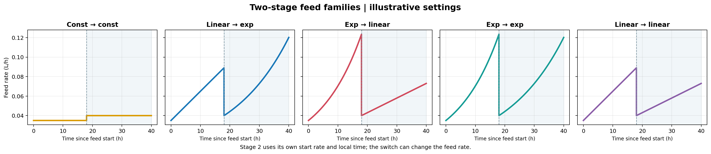
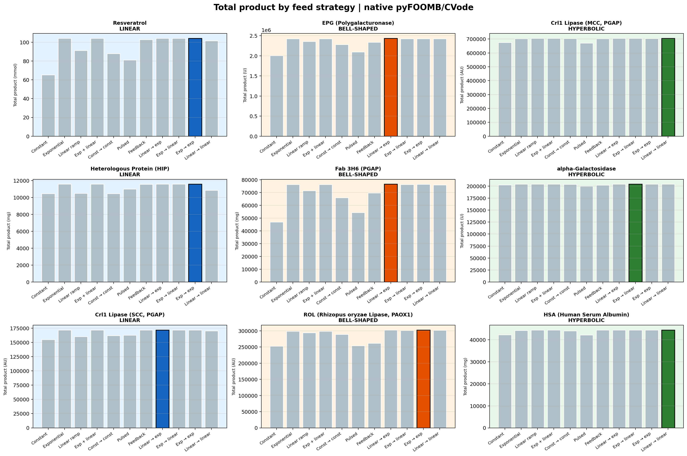
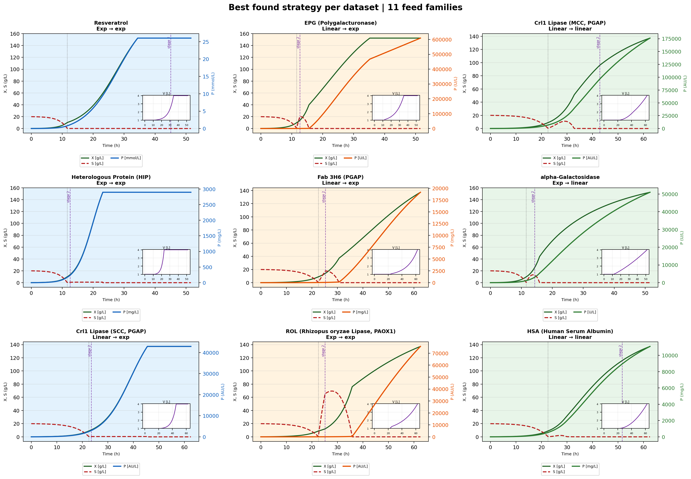
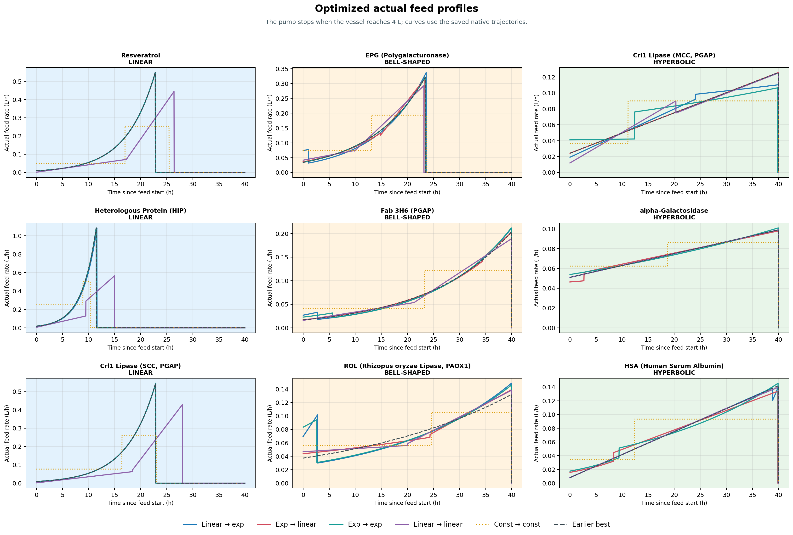

# The whole project in a minute

“In Semester VI, I built a browser interface for pyFOOMB, fitted nine literature-derived growth–production relationships, and simulated batch profiles. This semester I used those relationships to design fed-batch pump schedules. I held the reactor settings constant, optimised each schedule separately for each dataset, and compared total product at harvest. I expanded the comparison from seven to eleven feed families. The largest gain was 1.28% for ROL lipase, while five cases gained less than 0.01%.”

# Slide 1 · Title

Start with the project question. “Can I choose a feed schedule that gives my yeast enough substrate to grow and puts it in a productive growth range?” The yeast makes the product. pyFOOMB simulates the process. The optimiser proposes pump settings and uses those simulations to score them.

# Slide 2 · The feed design problem

$F(t)$ is how much liquid the pump adds each hour. It changes how much substrate the cells have, which changes their specific growth rate $\mu$. The fitted production rate $q_p$ tells me how much product one gram of biomass makes per hour at that growth rate. If $X$ is biomass concentration and $V$ is liquid volume, $XV$ is the total mass of biomass. Therefore the product formation rate for the whole vessel is $q_p(\mu)XV$.

**Say:** “The best operating point depends on both the production rate per gram and the amount of biomass available to make product.” A culture at the peak of the $q_p$ curve can still make less product over the run if it spends too long with little biomass.

# Slide 3 · The growth–production curves

The horizontal axis of a $q_p$–$\mu$ plot is specific growth rate in h$^{-1}$. The vertical axis is product formed per gram of dry biomass per hour. Depending on the product this can be mg, mmol, U or AU per gram per hour. The fitted curves are inputs to the reactor model.

- **Linear** $q_p=\alpha\mu+\beta$. $\alpha$ is how strongly production rises with growth and $\beta$ is the intercept.
- **Bell-shaped** $q_p=q_{p,\max}\exp[-(\mu-\mu_{\mathrm{opt}})^2/(2\sigma^2)]$. $\mu_{\mathrm{opt}}$ locates the peak and $\sigma$ controls its width.
- **Hyperbolic** $q_p=q_{p,\max}\mu/(K_q+\mu)$. $K_q$ gives half the plateau rate. At high growth, an extra increase in growth buys less extra production per gram.

The literature points were extracted and fitted using SciPy nonlinear least squares. The simulation evaluates these fits over a bounded growth-rate range and floors negative predictions at zero. “Linear” here refers to the biological fit. “Linear → linear” later in the deck refers to two consecutive pump ramps **over time**. The nine datasets cover yeast cases from *S. cerevisiae* and *P. pastoris*.

# Slide 4 · What I did across the two semesters

Semester VI supplied three pieces: the browser-based interface, the nine literature fits, and batch simulations for biomass, substrate and product. Semester VII put the batch and fed-batch models together, added feed start and pump shutoff events, then used the model to optimise and compare the schedules. The 99 cases are 11 feed families tested independently against each of nine datasets. They are simulations, so the comparison supports model-based conclusions.

# Slide 5 · Batch and fed-batch simulation

| Input | Value |
|---|---:|
| Initial biomass concentration $X_0$ | 0.1 g/L |
| Initial substrate concentration $S_0$ | 20 g/L |
| Initial product concentration $P_0$ | 0 |
| Initial liquid volume $V_0$ | 1 L |
| Feed starts at residual substrate | 0.5 g/L |
| Concentration of incoming substrate $S_{in}$ | 400 g/L |
| Pump-rate ceiling | 2 L/h |
| Working-volume ceiling | 4 L |
| Fed-batch simulation window | 40 h from feed start |

**Batch.** The pump stays off and the model volume stays at 1 L. Biomass grows, substrate falls, and product can accumulate. The solver locates the time when $S$ crosses 0.5 g/L. Each schedule begins from the same event state for that dataset, carrying through all four state variables. The two organism parameter sets are shared across cases using the same organism. The substrate and reactor settings are common model assumptions.

**Fed-batch.** The states are $X$ (biomass concentration), $S$ (substrate concentration), $P$ (product concentration) and $V$ (liquid volume). In the following equations, $Y_{X/S}$ is biomass formed per unit substrate consumed, $K_S$ is the substrate concentration giving half the maximum growth rate, and $D=F/V$ is the instantaneous dilution term.

$$
\mu=\mu_{\max}\frac{S}{K_S+S},\qquad
\frac{dX}{dt}=(\mu-D)X,\qquad
\frac{dS}{dt}=D(S_{in}-S)-\frac{\mu X}{Y_{X/S}}.
$$

$$
\frac{dP}{dt}=q_p(\mu)X-DP,\qquad \frac{dV}{dt}=F.
$$

The first term in the substrate balance is feed addition minus dilution. The second is yeast consumption. The feed adds liquid, so both biomass and product concentration have dilution terms. These terms do not remove accumulated biomass or product from the vessel. In particular, differentiating $PV$ gives $d(PV)/dt=q_pXV$ under this model. When volume reaches 4 L, an event turns the pump off. The states continue evolving through the remaining simulation time. Growth may continue briefly on residual substrate. $F/V$ and $\mu$ are distinct quantities.

# Slide 6 · How the optimiser works

1. **Choose the dataset and schedule family.** The $q_p$ fit and batch endpoint are fixed. The optimiser is allowed to change the schedule parameters inside their selected bounds.
2. **Simulate a candidate.** pyFOOMB Caretaker calls Assimulo/SUNDIALS CVode to integrate the state equations. Candidate parameters change the rate at each time. Switching, pulse edges and reaching 4 L are handled as events.
3. **Score it.** The objective is to maximise $P(t_f)V(t_f)$, the total product at the final time. Caretaker minimises, so the code returns its negative. The objective counts product already present from batch. This shared batch contribution does not change rankings within a dataset.
4. **Search.** Differential evolution keeps a population of parameter sets, generates trials by combining differences between candidates, and selects better-scoring trials over generations. In the extension, one search starts fresh (seed 42) and one is informed by earlier profiles and the fresh candidate (seed 43). Both use a 40-generation budget, population multiplier 14 and polishing.
5. **Replay and select.** The extension compared two search results and adapted earlier candidates for each new case. It replayed 972 candidates using relative tolerance $10^{-8}$ and absolute tolerance $10^{-11}$. The best replayed result was saved per case. The 63 earlier results came from the existing native Caretaker/pygmo study. The 36 new cases cover four families across nine datasets.

Fitting $q_p$ to literature and optimising feed are different computations. The first estimates a biological curve. The second uses that curve to select a control schedule. A solver check tells me whether the equations were integrated consistently. It does not measure how closely the equations represent an experiment.

# Slide 7 · Two-stage feed schedules

The horizontal axis starts at the first feed, hours after batch ends. The vertical axis is pump rate in L/h. The dashed marker at 18 h is an illustrative stage switch. In the optimisation the switch itself varies between 1 and 39 h. Stage 2 uses elapsed time $t-t_s$ and an independent starting rate $F_2$. A visible jump between stages is allowed. Biomass, substrate, product and volume carry through the switch continuously.

| Schedule | What the pump does |
|---|---|
| Constant | Delivers the same rate throughout feeding. |
| Exponential | $F_0e^{at}$ increases by a fixed proportion per hour. $a$ is a pump parameter. |
| Linear ramp | $F_0+kt$ increases by a fixed L/h each hour, so $k$ is measured in L/h$^2$. |
| Exp + linear | $F_0e^{at}+kt$ adds both contributions at every time. |
| Const → const | Uses a constant $F_1$ up to the switch and $F_2$ afterwards. |
| Pulsed | Alternates on and off. It varies the on-rate, period and fraction of each period spent on. |
| Feedback | Adjusts flow from the difference between target and simulated substrate. The growth target determines the substrate setpoint through the Monod equation. |
| Linear → exp | Starts with a linear ramp and switches to an exponential ramp. |
| Exp → linear | Starts with an exponential ramp and switches to a linear ramp. |
| Exp → exp | Uses two exponentials with different starting rates and exponents allowed. |
| Linear → linear | Uses two ramps with different starting rates and slopes allowed. |

The stage start rates and exponents or slopes are bounded independently. A zero slope or exponent is allowed in the new families, so a stage can be effectively constant. A scheduled switch after the tank fills has no influence on the actual feed.

# Slide 8 · Total product across eleven strategies

**Read across a single panel.** Each panel represents one product, and each bar is that strategy's best simulated final $PV$. The black-edged bar marks the highest score. The three coloured columns group the linear, bell-shaped and hyperbolic **kinetic fits**. The background is a category cue. Units and scales differ across panels. An activity unit is an assay reading, so a lipase activity bar cannot be interpreted as a mass of Fab.

The height of a bar reflects the chosen score only. It does not reveal which strategy filled the tank sooner, when biomass grew, or how the feed switched. Those questions need the time profiles. Differences below the resolution of the bars are easier to read in the gain table.

# Slide 9 · What changed after adding a second stage?

Subtract the earlier best from the expanded best, divide by the earlier best, and multiply by 100. For ROL, $100(302720.33/298896.08-1)=1.27946\%$. The earlier best is the best of seven schedules for that same product. It can differ between products.

| Dataset | Earlier best | Expanded best found | Gain |
|---|---|---|---:|
| EPG | Exponential | Linear → exp | 0.486675% |
| Fab case (labeled 3H6) | Exponential | Linear → exp | 0.402369% |
| ROL lipase | Exponential | Exp → exp | 1.279458% |
| Crl1 lipase (MCC) | Linear ramp | Linear → linear | 0.100662% |
| HSA | Linear ramp | Linear → linear | 0.003947% |
| Alpha-galactosidase | Linear ramp | Exp → linear | 0.009018% |
| Crl1 lipase (SCC) | Exponential | Linear → exp | 0.000968% |
| Heterologous protein (HIP) | Exp + linear | Exp → exp | 0.000634% |
| Resveratrol | Exponential | Exp → exp | 0.000453% |

**Say:** “ROL gave the largest gain over its earlier best. Even there, linear-to-exponential was close to exponential-to-exponential. Five datasets improved by less than one-hundredth of a percent.” The differences are model outputs. The searches used finite budgets, the fits were based on extracted data, and the reactor constraints were held common. A recorded winner is the highest evaluated score. Margins on this scale give no evidence of experimental significance.

# Slide 10 · Biomass, substrate and product profiles

- **Horizontal axis:** hours since the **start of batch**. The grey dotted marker is when feeding starts. The purple dashed marker is the scheduled change between two feed stages. The two markers refer to different events.
- **Left axis:** green solid line is biomass $X$ and dashed red line is substrate $S$, both in g/L. A substrate rise after the first marker means supply exceeded consumption at that point. A near-zero trace indicates low residual substrate at the scale shown.
- **Right axis:** product concentration $P$, in the units printed in that panel per litre. Its colour follows the kinetic group. Lines crossing on the page do not mean equal concentrations because the axes and units differ.
- **Inset:** liquid volume $V$ in litres. It stays at 1 L during batch and increases during feeding. A flat segment at 4 L indicates pump shutoff. Product concentration and total product are related by volume. The strategy bars use $PV$.

**Follow ROL in the bottom middle.** The batch runs about 22.53 h. The first feed starts, then the second stage begins 2.64 h later at about 25.17 h on this plot. The simulated residual substrate rises during early feeding and then falls as the growing culture consumes it. Product accumulates strongly later in the run. This is a model trajectory driven by the bell-shaped fit and biomass accumulation. The plot does not establish that the organisms in a real reactor would follow the same profile.

**Follow Resveratrol in the top left.** The nominal winner is labeled exp → exp, but the tank filled before the scheduled switch. Its second stage delivered no feed. Across all 36 new cases, 32 physically used their second stage and four did not. The same rule applies when reading the purple marker in any panel.

The saved event timings below help you locate each change in the nine graph panels. Add the batch time to a feed-relative time to locate it on the elapsed reactor clock. Full-volume times are taken from the first saved point at the ceiling.

| Dataset | Batch ends (h) | Stage switch after feeding starts (h) | First saved full-volume point after feeding starts (h) |
|---|---:|---:|---:|
| EPG | 11.58 | 1.02 | 23.62 |
| Fab case | 22.53 | 2.78 | 40.00 |
| ROL lipase | 22.53 | 2.64 | 40.00 |
| Crl1 MCC | 22.53 | 20.33 | 39.97 |
| HSA | 22.53 | 29.10 | 39.99 |
| Alpha-galactosidase | 11.58 | 2.71 | 39.99 |
| Crl1 SCC | 22.53 | 1.00 | 22.92 |
| HIP | 11.58 | 1.00 | 11.51 |
| Resveratrol | 11.58 | 33.45 (pump already off) | 22.81 |

\newpage

# Slide 11 · Actual pump rates during fed-batch

The horizontal clock now starts **when feeding begins**. The same ROL transition is therefore at **2.64 h** here. The vertical axis gives delivered feed rate in L/h after limits are applied. Four solid colours represent the four new families. The orange dotted step is constant → constant. The grey dashed line represents whichever of the earlier seven had the highest final product for that dataset.

Read the slopes to identify the feed laws. A jump between positive rates can be a switch. A final drop to zero is the pump stopping at 4 L. The area under a rate curve is the liquid volume delivered after the batch. The old and new strategies can use almost the same amount of liquid while delivering it at different times.

**ROL example.** The exp → exp run starts at about 0.083 L/h, ramps up, then drops to about 0.031 L/h at the stage change and ramps up again. The shape changes substrate availability and thus the time spent at different growth and production rates. The product response must be read from the state trajectories or final score. Airflow, oxygen limitation, and cooling demands are outside this model.

# Slide 12 · Closing answer

“I used the growth–production relationships from Semester VI to choose feed schedules in a batch-to-fed-batch model. The comparison tells me where a second feeding stage made a noticeable difference in the simulation and where simpler schedules performed nearly as well.”

# Companion figures outside the deck

- **Relative-performance heatmap.** Each row uses its own best result as 100%. A score of 99% means the strategy produced 99% of that dataset's best amount. Rounded labels can hide tiny differences.
- **Gain heatmap.** Each cell is the percentage gain or loss of a new strategy relative to the best of the seven earlier strategies in that row. A negative cell means that particular new schedule underperformed the earlier best.
- **Product accumulation.** Each curve is $P(t)V(t)$ on the feed-relative clock. This plot connects how soon a strategy makes product to how much it has accumulated at the end.
- **Working-volume check.** The horizontal reference line marks 4 L. This figure checks a constraint, whereas the main bars compare the objective.
- **Individual strategy profiles.** Each of the four new schedule families also has its own nine-panel $X/S/P/V$ figure. The same axes and event markers apply. Here the schedule is fixed across panels and each panel uses the best parameters found for that family.

# Questions you may be asked

**Why was the same initial substrate used?** It is a common simulation condition so each feed law confronts the same starting scenario. The nine cases carry their own fitted production functions and two organism-specific kinetic parameter sets. The numerical winners answer the shared-condition question.

**Why did we use total product instead of concentration?** Concentration can rise or fall as broth volume changes. $PV$ counts the material in the tank. Productivity per hour would be a different objective and could change the ranking.

**Why can the exponent differ from actual growth?** An exponential pump schedule can approximate a fixed growth rate under carbon limitation when the feed matches biomass demand. In our model actual $\mu$ is calculated from simulated substrate using the Monod expression.

**What checks support the numbers?** All 99 exported final volumes were at or below 4 L. The maximum relative biomass/substrate balance residual was $1.58\times10^{-7}$. Comparing matched CVode and LSODA simulations for the 36 new selected profiles gave a maximum product discrepancy of roughly 0.00003227%. Tests covered the switch clock, historical indexing, solver agreement and balance, constant-stage equivalence, and output sampling at the switch. These are numerical checks.

**Where can I check the precise numbers?** The expanded study's `final/feed_flow_results.csv` stores every case and pump parameter, `best_per_dataset.csv` stores the winners and near alternatives, and `two_stage_vs_previous.csv` stores percentage gains. The `profiles/` files contain the simulated time series. The plotting scripts read these saved outputs. The expanded study README records the model settings, search details and reproduction commands.

**What would I do after this project stage?** Connect the scenario presets and plots to the existing GUI, then validate against measured time courses with sourced conditions. This is a viva answer about future work. The deck ends with the completed optimisation study.
